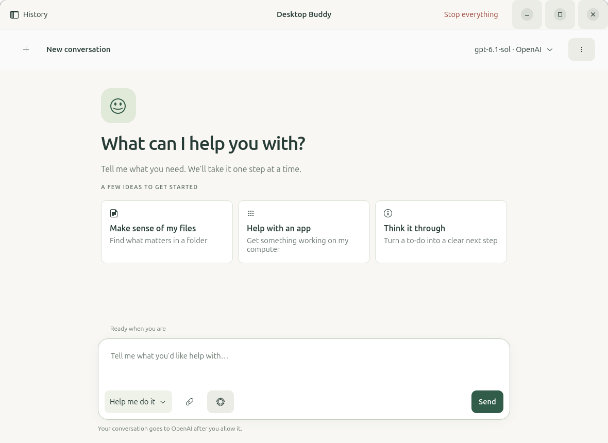
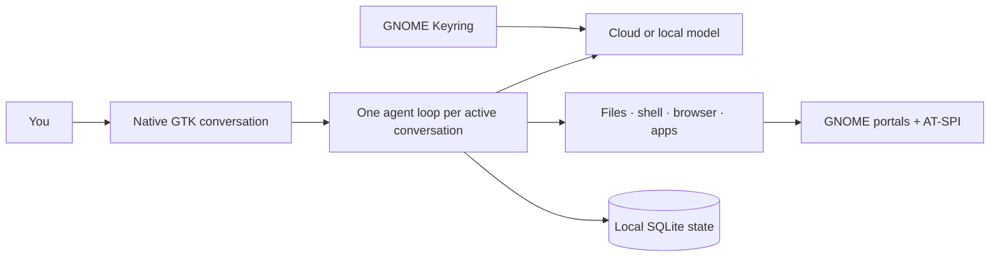

<div align="center">
  
  <h1>Desktop Buddy</h1>
  <p><strong>Tell your Linux desktop what you want done.</strong></p>
  <p>A native, local-first AI assistant for GNOME that can work with files, apps, browsers, terminals, images, and your screen.</p>

  <p>
    
    
    
    
    
  </p>
</div>



Desktop Buddy is built for people who want results, not an agent control panel. IT sets up the assistant; Jane describes the outcome and follows the work in a normal conversation. It runs as a standalone GTK app with local history, clear activity records, real cancellation, and three plain-language control modes.

> [!NOTE]
> Desktop Buddy targets Ubuntu 26.04 with GNOME Wayland. Version 0.4.10: a Copy button on every message and step, a Copy menu that can copy the whole conversation including work details, and replies that hit the response limit are retried in smaller steps instead of failing the task (cloud models now default to a 16k reply limit). Since 0.4.9 Buddy can change its own code and README when allowed (edit, test, commit with a new version, push to GitHub, restart), on top of one-click app connections for 26 services plus any pasted server address, a real "Just do it" mode, screenshot-based control of apps that expose no accessibility information, and an optional background browser. See [what is verified and what is not](docs/DELIVERY.md).

## Why it feels different

- **A desktop app, not a developer console.** Native GTK, conversation-first navigation, searchable history, drafts, attachments, and accessible controls.
- **Use the model you want.** OpenAI, Anthropic, xAI, Moonshot, OpenRouter, LM Studio, and Ollama have provider-specific adapters instead of one lowest-common-denominator shim.
- **Three plain choices.** **Discuss only** changes nothing. **Ask before acting** works in its folder and asks before everything else. **Just do it** acts without asking; Stop always works.
- **Real Linux control.** Work with files and commands, launch apps, drive an isolated Chrome window (visible or in the background), use accessible controls when an app has them, and click or type from a screenshot when it does not, through GNOME's screen and input portal.
- **Connected apps in one click.** Pick an app, sign in in your browser, done. Sign-in is saved in GNOME Keyring and reused. Any server address can be pasted too.
- **Local by default.** Conversations, tasks, preferences, memory, and audit records live in SQLite on your machine. API keys stay in GNOME Keyring.
- **Concurrent conversations.** Start a new conversation while others keep working. Each has its own replies, drafts, task, browser profile and Stop button. Background requests for approval are marked in history.
- **A stop button that means it.** Stop the current task or use **Stop everything** to cancel work, disconnect desktop control, and close Buddy's browser.
- **It can improve itself.** Turn on **Settings → IT setup → Let Buddy change its own code** and ask in plain words. Buddy edits its source checkout or this README on `main`, runs the test suite for code changes, commits (code with a raised version number), pushes to GitHub with the computer's existing sign-in after picking up newer commits, and restarts on new code. Sign-in keys and git internals stay off limits; a code commit is refused until the tests pass on exactly the files being committed, and Buddy never force-pushes.

## Run the development build

Desktop Buddy runs locally and requires no Buddy account, registration or sign-in. IT connects it directly to an existing local model or a cloud endpoint through **Settings → IT setup**. Leave the API key blank when the endpoint requires none; the endpoint decides whether credentials are needed. Service permissions for connected apps are separate from model setup.

```bash
git clone https://github.com/VincentAZ/Desktop-Buddy.git
cd Desktop-Buddy
./launch.sh --doctor
./launch.sh
```

The IT manager opens **Settings → IT setup → Add or configure a vendor…** to connect an existing LM Studio/Ollama service or a cloud provider. Cloud API keys are saved in GNOME Keyring. Select or enter a model, configure its capabilities, and run the connection/tool test. The upper-right model button shows the provider, exact model, and thinking level. Open it to switch saved models across providers or change thinking immediately. During a task, the button shows the model actually running and the menu explains which choice will apply to the next message. Choose **Sage**, **Paper**, or **Midnight** from the toolbar’s theme menu or **Settings → Appearance**; the theme applies to every Buddy window and is remembered after restart. A fresh installation asks IT to finish setup before Send becomes available. Changes during a task apply to the next task. This is a personal-workstation development build, not a hosted service.

Want an app-menu launcher and an isolated environment?

```bash
python3 scripts/install.py
```

The installer builds from this checkout without downloading packages, creates a private environment under `~/.local/share/desktop-buddy`, and adds a GNOME launcher. It does not install a background service or edit shell profiles. See [installation](docs/INSTALLATION.md) for system packages and troubleshooting.

## Run concurrent sessions

Start a task, then choose **New conversation** (Ctrl+N) and send another request. Switch between conversations in the sidebar while they keep running. **Stop** cancels only the conversation you are viewing; **Stop everything** cancels every task. Replies, attachments, follow-ups, approvals and progress stay with their conversation.

Each conversation gets a separate browser profile. For parallel browsing, turn off **Settings → Show the browser window while Buddy browses**. Tasks using the shared screen, mouse, keyboard or a visible browser take turns until the task using them finishes; waiting tasks can still be stopped. Files and external app accounts remain shared, so use separate work folders or filenames for unrelated tasks. Your model service may impose its own concurrency limits.

## Connect your apps

Click **Connect apps**, pick an app, click **Connect**. If the app wants a sign-in it opens in your browser; approve it and come back. Buddy remembers the connection and reconnects on its own later.

- **One click, verified live:** Notion, Linear, Atlassian (Jira/Confluence), monday.com, ClickUp, Todoist, Airtable, Dropbox, Canva, Webflow, Wix, Intercom, Zapier, Stripe, PayPal, Square, Vercel, Netlify, GitLab, Supabase, Neon, Prisma, Sentry, Cloudflare (two servers) and Cloudinary register Buddy automatically and open their sign-in page.
- **No account needed:** Microsoft Learn, DeepWiki, Context7, Exa web search, Hugging Face.
- **Paste a token:** GitHub (Buddy opens the page where you create one).
- **One-time key from the Desktop Buddy team:** Google (Gmail, Calendar, Drive, Docs, Sheets, Slides, Chat, Contacts, Classroom), Slack, Asana, HubSpot, Zendesk, Box and Figma only accept a client registered by the publisher. Ship it in `desktop_buddy/publisher.py`, or paste it once under **Settings → IT setup → App sign-in keys**; after that these apps show a normal Connect button.
- **Anything else:** paste the server address (or a local command) into the box at the bottom of **Add an app**. Buddy works out whether it needs a sign-in.

Buddy uses a connected app before its browser. For a website that is not connected, the browser (or the desktop) is used instead. See [MCP connections](docs/MCP.md).

## Pick your level of control

| Mode | Best for | What Buddy can do |
|---|---|---|
| **Discuss only** | Questions, planning, review | Read and explain; change nothing |
| **Ask before acting** | Everyday work | Work on files in its folder; ask before commands, typing, clicking, connected apps and sending data |
| **Just do it** | Hands-off work | Everything, without asking. You confirm this choice once; Stop still works |

No mode reads your saved passwords, bypasses Linux permissions, GNOME consent or **Keep Buddy offline**.

## What it can do

```text
“Sort these downloads into sensible folders and tell me what you changed.”
“Open the latest invoice, extract the totals, and create a clean CSV.”
“Use the browser to compare these three products and save a short report.”
“Run the test suite, diagnose the failures, fix them, and show me the diff.”
“Connect to my desktop and help me finish this form.”
```

Under the hood, Buddy includes:

- Workspace file tools with atomic writes and verified results
- Approved shell and script execution with offline network isolation
- Image attachments, screenshots, and visual inspection
- Excel, Word, PDF, CSV/TSV and text attachments with private saved copies; originals stay unchanged. Readers expose exact cells and formulas where available and report extraction limits.
- An isolated Chrome profile controlled through a private inherited pipe
- GNOME Remote Desktop portal support for pointer, keyboard, scroll, drag, and screenshots, including clicking at positions read from a screenshot
- AT-SPI application, window, and accessible-control inspection
- ComfyUI health checks, workflow runs, prompt batches, cancellation, and output collection
- Streaming tool calls, bounded retries, repeated-error detection, checkpoints, and explicit resume
- Persistent conversation history, per-conversation drafts, task records, audit events, and editable memory
- Self-modification tools that edit, test, version, commit, push and restart Buddy's own checkout under host-enforced rules

## Let Buddy improve itself

Turn on **Settings → IT setup → Let Buddy change its own code**, then ask in plain words: "add a dark blue theme", "make the Stop button easier to see", "update the README". Buddy works on its own source checkout on the `main` branch:

1. Reads the files it needs and writes the change.
2. For code, raises the version number in `desktop_buddy/__init__.py` and `pyproject.toml`, then runs the whole test suite until it passes. README, docs and image changes skip this step.
3. Commits with a plain-language message in your git name.
4. Pushes to GitHub with the SSH sign-in already on the computer, after pulling in anything newer there. It never force-pushes; a conflict stops it and tells you a manual merge is needed.
5. For code, restarts itself so the change is live, or shows a **Restart Buddy** bar if another conversation is still working. The new version number appears in the header.

In **Just do it** this runs without prompts; in **Ask before acting** you confirm the test run, the commit, the push and the restart. Git internals and sign-in key files stay off limits, and a code commit is refused until the tests pass on exactly the files being committed. The assistant's `self.*` tools and the `self-improve` skill implement this; see [security and privacy](docs/SECURITY.md) for the exact rules.

## Designed around honest boundaries

Desktop Buddy reports what it actually knows. Input events are marked as sent until a later observation verifies the result. Portal consent is never bypassed. Local-only mode blocks network tools, control of other apps and new ComfyUI workflows; those apps/custom nodes can use their own connections. It retains observation, files, isolated shell and trusted local inference. Completed external actions cannot be undone by the stop button.

Approval dialogs offer **Skip action**, **Allow once**, **Allow and stop asking** (switches to Just do it), and **Stop everything**. Activity details retain tool decisions and results.

Read [security and privacy](docs/SECURITY.md) for the exact trust boundaries.

## Architecture at a glance



There is no Electron runtime, permanent local web server, telemetry service, agent swarm, required Docker daemon, or bundled model download. MCP OAuth temporarily opens a loopback listener during sign-in.

## Test it

```bash
./scripts/run-tests.sh
./scripts/run-tests.sh --desktop   # opens dedicated test browser/terminal windows
.venv/bin/python scripts/verify.py --desktop  # bounded checks, fresh logs and JSON report
./launch.sh --smoke-test --data-dir .test-data/smoke
```

The suite covers provider protocols, tools, cancellations, credentials, conversations, state, portals, ComfyUI, model selection, YOLO behavior, and Buddy's self-modification rules. Native UI fixtures exercise compact and wide layouts, failure recovery, drafts, model switching, approval behavior, and the desktop-control shortcut.

## Project map

| Path | Purpose |
|---|---|
| `desktop_buddy/` | Application, providers, tools, desktop control, and native UI |
| `desktop_buddy/skills/` | Readable built-in workflow guidance |
| `tests/` | Deterministic unit and protocol tests |
| `scripts/` | Installer, diagnostics, UI checks, and physical workflow probes |
| `docs/` | Architecture, audit, security, provider, and validation evidence |

## Documentation

- [Architecture and design decisions](docs/ARCHITECTURE.md)
- [Installation and troubleshooting](docs/INSTALLATION.md)
- [Provider setup](docs/PROVIDERS.md)
- [Security and privacy](docs/SECURITY.md)
- [Audit findings and fixes](docs/AUDIT_2026-10-27.md)
- [Test evidence and known limits](docs/TEST_RESULTS.md)
- [Implementation plan](docs/PLAN.md)

Built for a Linux desktop where the assistant should explain itself clearly, act decisively, and stay out of the way.

## License

The original application code is free and open source under the [MIT License](LICENSE), copyright © 2026 Vincent Serpico. Use it, modify it, redistribute it, or build a business with it; keep the copyright and permission notice with copies or substantial portions of the code.

Third-party libraries, models, assets, and connected services retain their own licenses and terms. The MIT grant covers Desktop Buddy's original code and does not relicense those materials or services.
