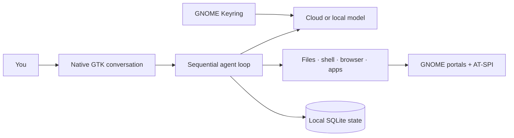

<div align="center">
  
  <h1>Desktop Buddy</h1>
  <p><strong>Tell your Linux desktop what you want done.</strong></p>
  <p>A native, local-first AI assistant for GNOME that can work with files, apps, browsers, terminals, images, and your screen.</p>

  <p>
    
    
    
    
    
  </p>
</div>


Desktop Buddy is built for people who want results, not an agent control panel. Choose a model, describe the outcome, and follow the work in a normal conversation. It runs as a standalone GTK app with local history, clear activity records, real cancellation, and three plain-language control modes.

> [!NOTE]
> Desktop Buddy is pre-alpha and currently targets Ubuntu 26.04 with GNOME Wayland. The deterministic suite passes 109 tests; live paid-model acceptance is still unverified. See the [full audit](docs/AUDIT_2026-10-26.md).

## Why it feels different

- **A desktop app, not a developer console.** Native GTK, conversation-first navigation, searchable history, drafts, attachments, and accessible controls.
- **Use the model you want.** OpenAI, Anthropic, xAI, Moonshot, OpenRouter, LM Studio, and Ollama have provider-specific adapters instead of one lowest-common-denominator shim.
- **Three understandable modes.** **Just discuss** makes no changes. **Help me do it** asks before sensitive steps. **YOLO — do anything** gets out of the way and skips Buddy's approval prompts.
- **Real Linux control.** Work with files and commands, launch apps, drive an isolated Chrome profile, inspect accessible UI controls, and use GNOME's screen and input portal.
- **Local by default.** Conversations, tasks, preferences, memory, and audit records live in SQLite on your machine. API keys stay in GNOME Keyring.
- **A stop button that means it.** Stop the current task or use **Stop everything** to cancel work, disconnect desktop control, and close Buddy's browser.

## Start in 30 seconds

```bash
git clone https://github.com/VincentAZ/Desktop-Buddy.git
cd Desktop-Buddy
./launch.sh --doctor
./launch.sh
```

Click **Set up Buddy**, choose an AI service and model, then type what you want. Cloud providers require your own API key; local providers require an existing LM Studio or Ollama service.

Want an app-menu launcher and an isolated environment?

```bash
python3 scripts/install.py
```

The installer builds from this checkout without downloading packages, creates a private environment under `~/.local/share/desktop-buddy`, and adds a GNOME launcher. It does not install a background service or edit shell profiles. See [installation](docs/INSTALLATION.md) for system packages and troubleshooting.

## Pick your level of control

| Mode | Best for | What Buddy can do |
|---|---|---|
| **Just discuss** | Questions, planning, review | Talk through the task without changing anything |
| **Help me do it** | Everyday work | Take actions and pause before sensitive steps |
| **YOLO — do anything** | Trusted tasks where speed matters | Run commands, edit files, use apps, and make online requests without Buddy approval prompts |

YOLO mode does not bypass Linux permissions, provider restrictions, offline mode, GNOME consent dialogs, or application security. You can switch a waiting approval to YOLO without restarting the task.

## What it can do

```text
“Sort these downloads into sensible folders and tell me what you changed.”
“Open the latest invoice, extract the totals, and create a clean CSV.”
“Use the browser to compare these three products and save a short report.”
“Run the test suite, diagnose the failures, fix them, and show me the diff.”
“Connect to my desktop and help me finish this form.”
```

Under the hood, Buddy includes:

- Workspace file tools with atomic writes and verified results
- Approved shell and script execution with offline network isolation
- Image attachments, screenshots, and visual inspection
- An isolated Chrome profile controlled through a private inherited pipe
- GNOME Remote Desktop portal support for pointer, keyboard, scroll, drag, and screenshots
- AT-SPI application, window, and accessible-control inspection
- ComfyUI health checks, workflow runs, prompt batches, cancellation, and output collection
- Streaming tool calls, bounded retries, repeated-error detection, checkpoints, and explicit resume
- Persistent conversation history, per-conversation drafts, task records, audit events, and editable memory

## Designed around honest boundaries

Desktop Buddy reports what it actually knows. Input events are marked as sent until a later observation verifies the result. Portal consent is never bypassed. Offline mode blocks Buddy's network tools, while actions inside another app may still use that app's connection. Completed external actions cannot be undone by the stop button.

Approval dialogs use direct choices: **Skip action**, **Allow once**, **Use YOLO**, and **Stop everything**. The separate activity view records tool decisions and results without turning the main conversation into a wall of diagnostics.

Read [security and privacy](docs/SECURITY.md) for the exact trust boundaries.

## Architecture at a glance



There is no Electron runtime, local web server, telemetry service, agent swarm, required Docker daemon, or bundled model download.

## Test it

```bash
./scripts/run-tests.sh
./scripts/run-tests.sh --desktop   # opens dedicated test browser/terminal windows
./launch.sh --smoke-test --data-dir .test-data/smoke
```

The suite covers provider protocols, tools, cancellations, credentials, conversations, state, portals, ComfyUI, model selection, and YOLO behavior. Native UI fixtures exercise compact and wide layouts, failure recovery, drafts, model switching, approval behavior, and the desktop-control shortcut.

## Project map

| Path | Purpose |
|---|---|
| `desktop_buddy/` | Application, providers, tools, desktop control, and native UI |
| `desktop_buddy/skills/` | Readable built-in workflow guidance |
| `tests/` | Deterministic unit and protocol tests |
| `scripts/` | Installer, diagnostics, UI checks, and physical workflow probes |
| `docs/` | Architecture, audit, security, provider, and validation evidence |

## Documentation

- [Architecture and design decisions](docs/ARCHITECTURE.md)
- [Installation and troubleshooting](docs/INSTALLATION.md)
- [Provider setup](docs/PROVIDERS.md)
- [Security and privacy](docs/SECURITY.md)
- [Audit findings and fixes](docs/AUDIT_2026-10-26.md)
- [Test evidence and known limits](docs/TEST_RESULTS.md)
- [Implementation plan](docs/PLAN.md)

Built for a Linux desktop where the assistant should explain itself clearly, act decisively, and stay out of the way.
